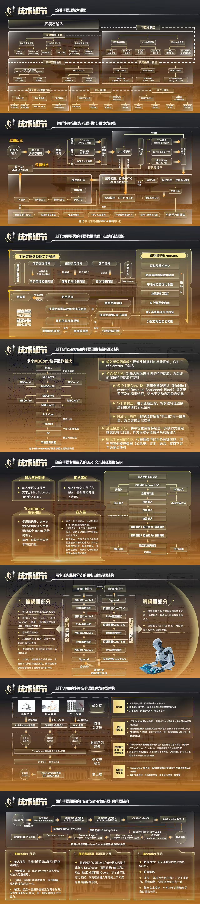

# 雇佣服务合同

甲方（委托人）：罗超能
乙方（劳务提供人）：吴健
丙方（付款及监督管理人）：哈尔滨新婧教育科技有限公司
统一社会信用代码：91230103MA7M73C02Q

---

## 一、服务内容和要求

1. 乙方根据甲方及丙方书面确认的任务要求开展工作，按期完成任务，包括但不限于完整的源代码、模型权重及相关成果。

2. 乙方应确保所提供的工作成果能够在甲方确认的数据集上实现双方认可的预测准确率，所述"预测准确率"系指在经甲乙双方确认的数据集及评估方法下测得的结果：
   - **评估指标**：Accuracy
   - **数据集划分方式**：8:2 随机划分
   - **目标准确率**：≥ 90%
   - 需提供训练准确率的评估指标、数据集来源、训练集与测试集划分方法、评估方式及具体数值。

3. 乙方承诺其所提供的项目专用工作成果为其独立完成，不侵犯任何第三方的知识产权或其他权利。在符合法律规定及开源协议的前提下，乙方可在项目中合理使用开源软件、预训练模型及第三方库，其使用行为经甲方/丙方确认后视为不构成侵权。

## 二、工作进度与监督管理

1. 乙方预计工作周期为 **15天**（自合同生效之日起计算），甲方应在约定期限内向乙方提供必要支持，如提供数据、服务器访问权限等。

2. 丙方代表甲方负责对乙方的工作进行监督、管理和沟通，并应及时向乙方传达甲方的需求和修改意见。

## 三、验收与交付

乙方完成全部工作内容后，应向甲方与丙方提交：
- 完整的源代码
- 模型权重
- 相关文档，并说明实现的预测准确率与评估方法

验收标准：
- 提交的代码和模型权重大致完整，可在经双方确认的数据集上运行
- 经甲乙方确认的评估方法测算的预测准确率达到约 90%（≥90%）
- 文档及说明完整，**可视化页面完整**，可展示模型的推理结果

甲方与丙方应在收到乙方交付成果后的七（7）个工作日内组织验收。

## 四、报酬及支付方式

- 总金额：**税前人民币叁仟伍佰元（¥3,500 元）**
- 支付时间：验收合格后七（7）个工作日内
- 支付方式：银行转账或甲乙双方认可的其他方式
- 注：该报酬为税前金额，乙方应自行承担并配合丙方依法代扣代缴的个人所得税及其他法定费用

## 五、权利归属与保密

1. 工作成果在通过验收并支付全部报酬后，项目专用知识产权和工作成果全部归甲方所有。
2. 各方应对在履行本合同过程中知悉的商业秘密及其他未公开信息承担保密义务。

## 六、违约责任

任何一方违反本合同约定，给其他方或第三方造成损失的，应承担违约责任并赔偿相应的损失。

## 七、合同的变更与解除

- 如需变更合同内容，应由三方协商一致后签署书面补充协议。
- 如甲方或丙方延迟提供必要支持或无正当理由阻碍乙方工作超过七（7）个工作日，乙方有权暂停工作或要求延长工期。
- 在验收合格、支付报酬并交付成果后，本合同自动终止。

## 八、争议解决

协商不成的，可向合同签订地（甲方所在地）人民法院提起诉讼。

---

## 关键技术指标（快速参考）

| 项目 | 要求 |
|------|------|
| 评估指标 | Accuracy |
| 数据集划分 | 8:2 随机划分 |
| 目标准确率 | ≥ 90% |
| 工作周期 | 15天 |
| 报酬 | ¥3,500（税前） |
| 交付物 | 源代码 + 模型权重 + 文档 + 可视化页面 |

---

## 技术架构图

架构包含8个核心模块：
1. 均衡手语理解大模型（多视态输入：手势/表情/文本/EMG）
2. 多模态信息增强-优化（LSTM-MLP + 强化学习）
3. 基于增量聚类的手语数据管理（K-means）
4. 基于EfficientNet的手语图像特征提取
5. 融合BERT的文本特征提取（Transformer）
6. 多任务EMG信号编解码（Conv3x3 编码器/解码器）
7. 基于VMs的多模态手语理解大模型（EfficientNet + EMG + 文本）
8. 跨模态Transformer编码器-解码器结构
